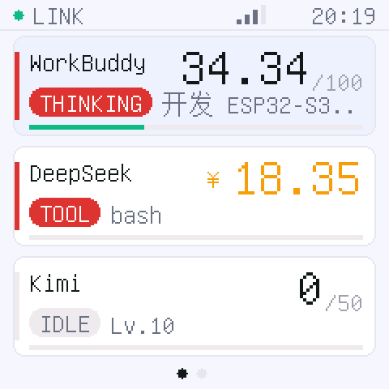
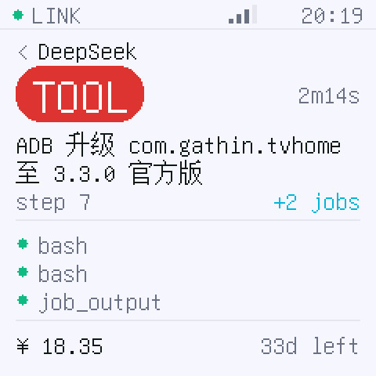
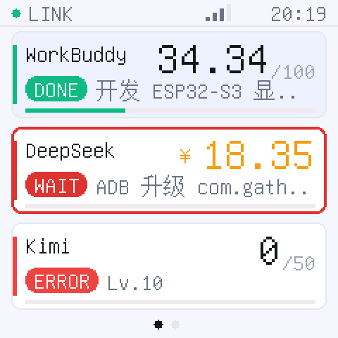
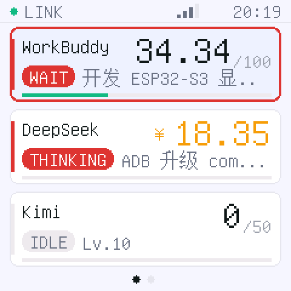

# AI余光

> 桌上一块 240×240 的小屏，替你盯着三个 AI Agent：谁在干活、谁在等、还剩多少钱。


把 **WorkBuddy**、**DeepSeek Harness**、**Kimi** 三个 Agent 的任务进度和剩余额度，
显示在桌上的 Waveshare ESP32-S3-Touch-LCD-1.54（240×240）小屏上。
抬眼扫一下就知道，不用切窗口、不用掏手机。

| 总览（三张卡） | 单个详情 | 状态胶囊 | 等确认在闪 |
| --- | --- | --- | --- |
|  |  |  |  |

`IDLE` 灰、`THINKING`/`TOOL` 红、`DONE` 绿、`WAIT` 红闪、`OFFLINE` 褪成浅灰——
**桥接断了就不装活着**，数字一起变灰，不会拿上一次的存量骗你。

## 它是怎么工作的

架构是「电脑端取数 → 设备端只做显示」：设备是个哑终端，自己不读任何数据，也不持有 API Key，
每 2 秒向电脑要一次状态。

```
WorkBuddy(本地 SQLite) ┐
DeepSeek Harness(事件日志) ├─→ bridge(Node, 零依赖) ─→ HTTP/JSON ─→ ESP32 ─→ 屏幕
Kimi(余额 API + 进程)   ┘
```

这么做的好处：额度结算、token 续期这些麻烦事都留在电脑上，固件里没有一行网络鉴权代码。
代价是**电脑上的桥接必须常驻**——所以它被做成了一个菜单栏 App，开机自启、崩了自动重启。

## 名字

「余光」是"用余光扫一眼就知道"——这块屏不该被正眼盯着看。而且**余光**和**余额**同音，
它屏幕上确实一半是余额。前缀 `AI` 点明它盯的是谁。

内部代号 `deskpulse`（bundle id、配置目录、日志名都还用它）。

---

## 现在能跑什么

| 部分 | 状态 |
| --- | --- |
| 桥接：三家数据聚合、HTTP、SSE、UDP 自动发现 | ✅ 已在本机真实数据上跑通 |
| dsh 事件日志增量解析（多帧 zstd） | ✅ 有单元测试，含半帧写入的容错 |
| 固件：三卡总览 / 详情页 / 信息页、触摸、按键 | ✅ **已烧录到真板并跑通**（Flash 20%，RAM 15%） |
| 界面排版 | ✅ 内置桌面预览器，不插板子也能看效果 |
| 端到端：Wi-Fi → UDP 发现 → 拉取 → 上屏 | ✅ 实测通过（见下方验证记录） |
| 断连降级与自动重连 | ✅ 实测通过（`bridge LOST` → `OFFLINE` → `ONLINE`） |
| 陀螺仪（QMI8658）自动转屏 + 触摸同步逆变换 | ✅ 已烧录，`imu=ok`，方向映射已验证自洽 |
| 插电脑不熄屏 / 供电来源识别 | ✅ `pwr=USB 100%`，默认永不熄屏 |
| Mac 菜单栏 App（自带 node，一键安装） | ✅ 实测通过：开机自启 / 崩溃自愈 / 孤儿进程回收 |
| agent 弹框时卡片红闪提醒 | ✅ WorkBuddy / DeepSeek Harness 已端到端验证；Kimi 不支持 |
| 阈值蜂鸣、OTA、USB 兜底通道 | ⬜ 未做（原 P1） |

---

## 快速开始

### 0. 装成 Mac App（推荐，不用管终端）

`package/dist/AI余光-0.1.1.zip` 是可直接双击的菜单栏 App，**自带 node 运行时**，
不需要本机装 Node，也不依赖 WorkBuddy 是否开着。

```bash
# 解压后把「AI余光」拖进 /Applications，或者：
ditto package/dist/AI余光.app "/Applications/AI余光.app"
open "/Applications/AI余光.app"
```

启动后菜单栏出现 `● AI余光`：绿点=在线、橙点=引擎在跑但探测不到、红点=引擎没起来。
Dock 里没有图标（`LSUIElement=1`）。点开菜单是：

| 菜单项 | 作用 |
| --- | --- |
| `运行中 · 127.0.0.1:8787 · WorkBuddy / DeepSeek / Kimi` | 只读状态行，显示当前在线的数据源 |
| `打开状态页` | 浏览器打开 `127.0.0.1:8787/v1/state` |
| `重启桥接` | 杀掉引擎再拉起，改完 `config.json` 后点这个 |
| `查看日志` | 打开 `~/Library/Logs/DeskPulse.log` |
| `登录时自动启动` | 勾选后注册到「系统设置 → 通用 → 登录项」 |
| `退出AI余光` | 退出，顺带把引擎收走 |

App 自己做三件事：拉起引擎子进程（`Contents/Resources/node`）、崩了自动重启、
退出时把子进程一起收走。下面这些行为都实测过：

```bash
# 只杀 App 主进程 → node 子进程 4 秒内自己退出（日志写"父进程已退出，桥接跟着收工"）
pkill -f "AI余光.app/Contents/MacOS/yuguang"

# 只杀 node 子进程 → App 立刻重启它，端口仍是 8787，/healthz 恢复 ok
kill -9 $(lsof -nP -iTCP:8787 -sTCP:LISTEN | awk 'NR==2{print $2}')

# 重复 open 不会起第二个实例
"/Applications/AI余光.app/Contents/MacOS/yuguang" --status
# online=true port=8787 providers=WorkBuddy,DeepSeek,Kimi login=on
"/Applications/AI余光.app/Contents/MacOS/yuguang" --version
# AI余光 0.1.1
```

配置文件在 `~/Library/Application Support/DeskPulse/config.json`（首次启动自动生成），
额度历史在同目录 `data/quota_history.jsonl`。**这两个位置和 App 装在哪无关**，
以后替换新版 App 不会丢配置。

> 目录、日志名、bundle id 里仍然是 `DeskPulse` / `deskpulse`——那是内部标识，
> 改显示名不该动它们，否则配置和额度历史都得迁移一遍。

> ⚠️ 先拖进 `/Applications` 再勾「开机自启」。登录项注册的是程序当前路径，
> 装好之后再移动 App，登录项会失效，重新勾一次即可。

自己重新打包：

```bash
cd package && ./build-app.sh     # 产出 dist/AI余光.app + dist/AI余光-0.1.1.zip
```

**图标**是「一只偏头用余光看人的眼睛」——名字叫 AI余光，所以画的是"看"，而且是斜着看。
配色跟着桌面小屏走：奶油白 `#FFF8F0`、暖橙 `#FFB05C`、珊瑚 `#FF8A5B`、深棕 `#4A3B32`。
重新生成：

```bash
cd package/icon && ./build-icon.sh   # 素材 → 裁切 → 各尺寸 → AppIcon.icns
```

素材是 AI 生成的，右下角带「AI生成」水印，所以 `make-icon.swift` 里的第一步是**裁切**而不是涂抹——
眼睛和星芒都在画面中部，裁一个以眼睛为中心的正方形就能完全避开，而且裁出来的奶油底色
本身就是图标底板，不存在拼接痕迹。裁完再套 macOS 的图标网格（1024 画布 / 824 内容区 / 圆角 185.4 / 投影），
否则满版直角方图放进 Dock 会比别的图标大一圈。换图标时只要给一张主体居中的原图，调裁切参数即可。

方案对比与踩坑记录见 [`docs/packaging.md`](docs/packaging.md)。

### 1. 起桥接（电脑端，开发用）

不想装 App、只想临时跑一下：

```bash
cd bridge
node --version          # 需要 22+（用到内置 node:sqlite 与 zlib zstd）
node deskpulse-bridge.mjs
```

打开 <http://127.0.0.1:8787/v1/state> 应该能看到三家状态。

**桥接是必须常驻的**：板子只是个哑显示终端，自己不读任何数据，每 2 秒 `GET /v1/state` 拉一次。
桥接一停，板子还在跑（Wi-Fi、触摸、自动转屏都正常），但拿不到新数据。

想让它在后台常驻，**优先用上面的 App**（自带 node、有菜单栏可见、能开机自启）。
如果就是要从源码跑并常驻：

```bash
./install-launchd.sh          # 装成 LaunchAgent，登录自启，进程崩了自动重启
./install-launchd.sh uninstall
```

> 两条路别同时用：`install-launchd.sh` 和 App 都会去抢 8787，先跑起来的那个赢，
> 后跑起来的会显示「外部实例占用 8787」。

⚠️ 不装的话，桥接的寿命跟着启动它的那个终端/IDE 走：关掉 WorkBuddy 或那个终端窗口，
进程就没了（实测 `pgrep` 里的 pid 会直接收到 SIGTERM 退出）。**注意 node 用的是
WorkBuddy 自带的版本**（`~/.workbuddy/binaries/node/...`），卸载 WorkBuddy 会让这个
LaunchAgent 失效；换系统 node 可以用 `NODE_BIN=/usr/local/bin/node ./install-launchd.sh`。

**桥接断了屏幕长什么样**（`docs/preview/preview_offline.png`）：
顶栏 `NO LINK` + `RETRY` 变红，三张卡的胶囊统一变灰 `OFFLINE`，数字和底部进度条一起褪成浅灰——
表示"这是最后一次的存量，不是实时值"。断链超过 10 秒进入这个状态，恢复后 2 秒内自动回来。

### 2. 什么都不用配（默认读本地登录态）

三家都不需要你填 API Key。桥接直接读本机 app 已有的登录态：

| 读取对象 | 位置 | 用途 |
| --- | --- | --- |
| DeepSeek Platform grant | `~/.dsh/.credentials.yaml`（权限 600） | 查真实钱包余额 |
| Kimi refresh_token | `~/Library/Application Support/kimi-desktop/Local Storage/leveldb` | 换 access_token 再查每日额度 |

只要这两个 app 在本机登录过一次，桥接就能自己续期：Kimi 的 refresh_token 有 90 天，
桥接用它换 30 天的 access_token，**不需要 app 一直开着**。

想换回官方 API Key 的方式（比如你在别的机器上跑桥接）：

```bash
cp config.json config.local.json && chmod 600 config.local.json
```

```json
{
  "providers": {
    "deepseek": { "localAccount": false, "apiKey": "sk-..." },
    "kimi": { "localSession": false, "apiKey": "sk-..." }
  }
}
```

或者用环境变量 `DEEPSEEK_API_KEY` / `MOONSHOT_API_KEY`。两条路都在：本地优先，失败自动回落到 Key。

### 3. 烧录固件

**省事路线：直接烧 Release 里的预编译镜像**（不用装 PlatformIO，只要 esptool）：

```bash
pip install esptool
esptool.py --chip esp32s3 -p /dev/cu.usbmodem101 -b 460800 \
  write_flash 0x0 AIYuguang-0.1.1-esp32s3-16MB.bin
```

那个 `.bin` 已经把 bootloader + 分区表 + 应用合并好了，所以偏移是 `0x0`，一条命令搞定。
烧完设备自动进配网模式（见下一节），**已保存的 Wi-Fi 配置会保留**；
想连配置一起清掉就先 `esptool.py ... erase_flash`。

Waveshare 出厂固件是小智 AI，第一次覆盖要先按住 BOOT 再插 USB 进下载模式。

**从源码编译：**

```bash
cd firmware
./flash.sh                    # 自动找串口烧录
./flash.sh build              # 只编译
```

`flash.sh` 里替你处理了两个本机环境的坑：`PYTHONPATH` 里的安全删除钩子会打断 PlatformIO
的清理流程，以及 TMPDIR 需要可写。

> ⚠️ **改完源码务必用 `./flash.sh build`，别直接 `pio run`。** 如果 `PYTHONPATH` 里带着那个
> 安全删除钩子，清理步骤会被静默拦掉，SCons 可能**不重编却照样报 SUCCESS**——你以为编了，
> 实际 `firmware.bin` 的时间戳还停在几小时前。
> 写这份文档时就踩了：改完界面文案跑 `pio run` 报成功，烧进去发现屏幕上的字没变。
> 判断是否真重编了，看 `ls -la .pio/build/*/firmware.bin` 的时间戳，或者直接
> 在 `.bin` 里搜文案的 UTF-8 字节。

想自己重新生成合并镜像（比如改了代码之后发版）：

```bash
pio run
B=.pio/build/waveshare_lcd_154
python3 ~/.platformio/packages/tool-esptoolpy/esptool.py --chip esp32s3 merge_bin \
  -o dist/固件名.bin --flash_mode qio --flash_freq 80m --flash_size 16MB \
  0x0 $B/bootloader.bin 0x8000 $B/partitions.bin \
  0xe000 ~/.platformio/packages/framework-arduinoespressif32/tools/partitions/boot_app0.bin \
  0x10000 $B/firmware.bin
```

### 4. 设备配网

首次上电（NVS 里没有 Wi-Fi）：

1. 屏幕显示 `SETUP MODE`，手机连 `Yuguang-xxxx`，密码 `yuguang`
2. 浏览器打开 `192.168.4.1`，填 Wi-Fi 名称/密码，电脑地址**可留空**（会 UDP 自动发现）
3. 保存后设备自动重启并开始拉数据

### 5. 操作

| 操作 | 效果 |
| --- | --- |
| 点卡片 | 进详情页（状态机、耗时、最近 3 个工具、额度） |
| 点左右两侧滑动 | 总览 ↔ 信息页 |
| 详情页任意位置点一下 | 返回总览 |
| BOOT 短按 | 亮度 30 / 60 / 100 循环 |
| BOOT 短按（**在信息页**） | 屏幕朝向校准：整体旋转 +90°，自动存 NVS（详见下节） |
| BOOT 长按 5s | 清空 Wi-Fi 配置重新配网 |
| USER(板载第二个键)短按 | 三页循环 |
| 转动设备 | 画面自动转正（详见下节） |

**状态标签配色**：卡片第二行和详情页的状态都是一个圆角胶囊（`fillRoundRect`，圆角取高度一半）；
卡片左侧那条 3px 竖条跟胶囊同色，扫一眼就知道哪张在跑、哪张完事了。

| 状态 | 胶囊 | 含义 |
| --- | --- | --- |
| `THINKING` / `TOOL` | 🟥 红底白字 `#DC3535` | 任务进行中 |
| `DONE` | 🟩 绿底白字 `#10B981` | 任务结束 |
| `WAIT`（awaiting） | 🟥 **红底白字，会闪** | **agent 弹框问你要权限，卡在等你点头** |
| `ERROR` | 🟥 红底白字 `#EF4444` | 出错 |
| `IDLE` / `OFFLINE` | ⬜ 浅灰底深灰字 | 空转，压下去不抢眼 |

`WAIT` 和 `ERROR` 都是红，靠**动与静**区分：`WAIT` 会呼吸，`ERROR` 是常亮。
不用再加一种颜色，因为多一种色就是在增加辨认成本。

### 弹框提醒（`WAIT` 的呼吸）

三个 agent 干活时都会弹框要权限或者问你问题，但**你人不在电脑前就看不到**。所以：

- 卡片描边和胶囊一起以 **1 Hz 呼吸**，左侧色条同步——余光扫过去先看到边框在跳
- **闪 30 秒后转常亮**。一直闪的话，一小时后你会开始主动无视它，那比不提醒更糟
- 暗的那半帧是"淡红底 + 红字"，**不是消失**——否则会看成"闪没了"，还是不知道它在等人
- 有卡片在呼吸时，重绘从 1 s 提到 250 ms；平时维持 1 s（软件旋转一帧 3–5 ms，代价可忽略）

**怎么知道你在等确认**：两家都把这个状态写进了本地文件，但位置和字段完全不同。

**WorkBuddy** — `~/.workbuddy/audit-log/YYYY-MM-DD.jsonl`，靠 `toolCallId` 配对：

```
file-safety.needs-approval        ← 弹框出现
file-safety.approved / .rejected  ← 你点了允许 / 拒绝
```

实测样例（2026-11-07 20:11:03 → 20:11:15），中间那 12 秒就是人读弹框再点允许的时间。
覆盖 `file-safety.*`、`file-safety.bulk-delete.*`。`network.*` 暂不纳入——历史日志里
`ask-matched` 35 次 / `approved` 29 次，不是一一对应，配对关系还没实测清楚，收进来会误报。

**DeepSeek Harness** — 直接写在会话日志里，靠 `data.id` 配对：

```
approval/asked    { id, toolName, callId, reason }   ← 弹框出现
approval/decided  { id, outcome }                    ← allowed-once / denied…
```

实测样例（2026-11-07 22:54，`bash` 要求把沙箱升到 danger-full-access 去写工作区外的目录，
2.5 秒后 `allowed-once`）。等待期间卡片会显示被问的工具名。

两家的解析都是纯文件操作、不写任何东西：WorkBuddy 的在 `bridge/lib/approval.mjs`，
dsh 的在 `adapters/dsh.mjs` 的事件状态机里。各自有单测（`tests/approval.mjs`、
`tests/dsh-approval.mjs`），都不需要那两个 app 装在本机。

**Kimi 还不支持。** 它是 Electron 应用，权限框只活在渲染层、磁盘上不留痕，
只能走 macOS 辅助功能 API 读窗口——要用户授权且容易随版本更新打掉，暂时不做。

配色和呼吸节奏集中在 `ui.cpp` 的 `badgeStyle()` / `awaitingLit()` / `kAwaitBlinkMs` 几处，
改颜色和闪多久只动那里。

### 6. 屏幕方向与供电

**自动转屏**：板上 QMI8658 的加速度计判断重力方向，把画面转成 0/90/180/270 四档。

- 面板本身固定以 rotation 0 驱动，旋转在软件里做（这块屏是 240×240 正方形，
  自己转像素比让 Arduino_GFX 处理旋转偏移更可控）。触摸坐标会同步做逆变换，
  所以转过之后点卡片、滑动手势方向都是对的。
- **平放不动**：in-plane 重力小于 0.35 g 时"哪边是上"没有意义，保持当前方向，
  放桌上不会自己乱转。
- 防抖：倾角超过约 33° 才允许切换，且要连续 5 次采样（约 1 秒）方向一致才生效。
  开机第一次采样直接采用，不用等 1 秒。

四个姿态的对应关系（重力是静止时加速度计读到的**朝上**向量，所以画面要正，
逻辑的"下"就必须落在 `(-ax, -ay)` 上）。下表是**象限**，最终档位再套一个整体偏移
`IMU_ROT_OFFSET`（出厂 2，真机实测确定）：

| 物理姿态 | 加速度计读数 | 重力朝屏幕 | 象限 `base` | 实际档位 `r=(base+2)&3` |
| --- | --- | --- | --- | --- |
| 竖持（如 USB 口朝下） | `ay ≈ -1` | 下 | 0 | `r=2` |
| 转 90°（`ax` 正） | `ax ≈ +1` | 左 | 1 | `r=3` |
| 倒持 | `ay ≈ +1` | 上 | 2 | `r=0` |
| 转 90°（`ax` 负） | `ax ≈ -1` | 右 | 3 | `r=1` |

**为什么要分"象限"和"偏移"两层**：象限只描述"四个方向之间差 90°"，这层是纯几何、
不依赖具体硬件；而"面板哪一边算正上方"取决于屏幕和 IMU 在板子上的相对安装，只能实测。
把两件事分开，换一块板子只需改偏移，不用动映射公式。

`ax` 和 `ay` **都要**取负。早先只给 `ay` 取了负、漏了 `ax`，结果两个横向姿态都差
180°，只有竖向的正/倒能对上——这种错肉眼在代码里看不出来，所以旋转公式已经抽到
`src/rotate.h`，并配了主机端测试 `tools/test_rotation.cpp`（用独立几何参考实现逐像素
比对，同时校验触摸逆变换和"转 4 次回原图"）：

```bash
cd firmware
g++ -O1 -I src -o /tmp/rot_test tools/test_rotation.cpp && /tmp/rot_test
```

改 `rotate.h` 里的公式之后**必须**跑这个测试再上机。

### 屏幕朝向不对？不用重烧，机器上直接调

翻到信息页（第 3 页，`tilt` 一行会显示 `90 deg  off 2` 这样的当前状态），
**短按 BOOT 键**：每按一次整体偏移 +1，画面立刻转 90°，选到正为止。
选完自动存进 NVS，重启后保持。

- 信息页上 BOOT 短按 = 调朝向；其他页面上 BOOT 短按还是调亮度（原来的行为没变）。
- 改 `src/board_config.h` 的 `IMU_ROT_OFFSET` 只影响**出厂默认值**（NVS 里没存过时的初值）。
- 想恢复出厂：长按 BOOT 5 秒重新配网时不会清这个值；要清就 `IMU_ROT_OFFSET` 改好重烧。

串口里能看到全过程：`[dp] imu quad=N ax=… ay=… -> base=N off=2`、`[dp] rotate=N (… deg)`、
`[dp] rot_offset=3 (r=1)`。

**不熄屏**：固件默认**永不熄屏**（`DP_BLANK_AFTER_MS = 0`），插在电脑上一直亮着。
想让电池供电时省电，把 `board_config.h` 里 `DP_BLANK_AFTER_MS` 改成 `300000`（5 分钟），
此时仅在没有 USB 供电时才熄屏，USB 供电无论怎么设都不会熄。触摸或按键会立刻点亮。

供电来源判定三条判据任一成立即视为 USB：USB 外设枚举到主机（`Serial.isPlugged()`）、
电池电压 > 4.15 V（只可能是在充电）、量不到电池（没装电池）。信息页 `power` 一行会显示
`USB 87%` / `BAT 42%`。

---

## 数据从哪来（重要，别被数字骗了）

| 供应商 | 进度 | 额度 | 精度说明 |
| --- | --- | --- | --- |
| WorkBuddy | `~/.workbuddy/workbuddy.db` 的 `sessions.status` + `session_usage` | 本地累计 credit ÷ 你设的预算 | 官方没有余额接口，**这个数字是自建口径**，可在 `config.json` 里改 `budgetCredits` |
| DeepSeek Harness | `~/.dsh/sessions/*/session-*.jsonl.zstd` 事件流（turn/step/tool/job） | Platform 钱包余额（充值 + 赠送） | 进度精确；余额读 `~/.dsh/.credentials.yaml` 的登录态，**无需 API Key**，和桌面端显示同一个数 |
| Kimi | 进程存活 + `kimi-agent/` 的会话状态与上下文占用 | 每日「深度研究 / 图像生成」剩余次数 | **进度是估算**（桌面端没有明文会话日志）；额度读桌面版本地登录态，**无需 API Key** |

> 为什么 Kimi 显示 `0/50` 而不是 ¥：Kimi 是订阅制，会员没有可花的余额，
> 它的「剩余额度」就是每天的研究次数（默认 50）和图像次数（20）。
> 想改看图像次数：`config.json` 里把 `kimi.quotaSource` 设成 `"image"`。

余额类数字是「采样差分」算出来的：桥接每 60 秒取一次余额，落盘到 `bridge/data/quota_history.jsonl`，
用下降量算今日消耗，用近 7 日均耗推算「还能用几天」。

隐私边界：桥上只传工具名、步数、耗时、金额和任务标题（≤30 字），不传提示词和模型输出正文。
登录令牌只在桥接进程内用于请求对应厂商自己的接口，不写日志、不出本机。

---

## 目录

```
deskpulse/
├─ bridge/
│  ├─ deskpulse-bridge.mjs        主程序：聚合 + HTTP + SSE + UDP 发现
│  ├─ adapters/workbuddy.mjs      SQLite 只读
│  ├─ adapters/dsh.mjs            事件日志增量解析
│  ├─ adapters/kimi.mjs           余额 API + 进程探测
│  ├─ lib/zstdframes.mjs          多帧 zstd 分帧解压
│  ├─ lib/approval.mjs            从审计日志识别"正在等你确认"（纯文件，可单测）
│  ├─ lib/quota.mjs               余额采样历史 / 日耗 / 可用天数
│  ├─ tests/dsh-incremental.mjs   增量解析测试（含半帧）
│  ├─ tests/contract.mjs          固件↔桥接字段契约测试
│  ├─ tests/approval.mjs          等确认检测的单测（不需要 WorkBuddy）
│  ├─ tests/dsh-approval.mjs      dsh 审批事件的单测（合成日志）
│  └─ install-launchd.sh          常驻服务
├─ package/
│  ├─ main.swift                  菜单栏程序（管引擎子进程）
│  ├─ build-app.sh                打包 .app + zip
│  └─ icon/
│     ├─ build-icon.sh            素材 → 裁切 → iconset → icns
│     ├─ make-icon.swift          裁掉水印、套 macOS 图标网格
│     ├─ AppIcon.icns             产物：16~1024 全尺寸
│     └─ raw/                     生成的原图（含水印，仅作素材留档）
└─ firmware/
   ├─ src/main.cpp                主循环、页面状态机
   ├─ src/ui.cpp                  240×240 三个页面
   ├─ src/canvas.cpp              自绘控件 + 点阵文字
   ├─ src/font_data.h             中文点阵（GB2312 6763 字 + ASCII，218 KB）
   ├─ src/net.cpp                 Wi-Fi、配网门户、HTTP、UDP 发现
   ├─ src/input.cpp               CST816 触摸 + 三个按键
   ├─ src/display.cpp             ST7789 + 背光
   ├─ src/rotate.h                 整帧旋转 + 触摸逆变换（纯头文件，可在电脑上测）
   ├─ src/imu.cpp                 QMI8658 加速度计 → 屏幕方向
   ├─ src/power.cpp               电池 ADC + USB 供电判定
   ├─ src/board_config.h          引脚（见文件头注释的来源说明）
   ├─ tools/preview.cpp           桌面渲染预览
   ├─ tools/test_rotation.cpp     旋转公式主机测试
   └─ tools/gen_font.py           从 Unifont 生成点阵表
```

---

## 开发辅助

**不插板子看界面**（改完 `ui.cpp` 直接出图）：

```bash
cd firmware
g++ -std=c++17 -O2 -I src src/canvas.cpp src/ui.cpp tools/preview.cpp -o /tmp/preview
cd /tmp && /tmp/preview && python3 <项目>/firmware/tools/ppm2png.py
# 得到 8 张：overview / detail / info / states / offline / await_on / await_off / await_steady
```

第四张 `preview_states.png` 是把 DONE / AWAITING / ERROR 三种结局摆在一起，专门看状态胶囊配色——
改 `badgeStyle()` 之后先看这张，别直接上机（屏幕上配色错了我看不见，得靠这张图先自查）。

后三张是 `WAIT` 的呼吸三帧：亮、暗、以及超过 30 秒后的常亮。
**判据是文件哈希**：`await_on` 和 `await_steady` 必须字节完全相同（常亮压过闪烁），
和 `await_off` 必须不同。改呼吸逻辑后直接 `md5` 对一下，比盯着屏幕猜靠谱。

`WAIT` 的检测逻辑另有单测，不需要 WorkBuddy 也能跑：

```bash
cd bridge
node tests/approval.mjs      # WorkBuddy：配对 / 增量 / 半行 / 过期，10 项
node tests/dsh-approval.mjs  # dsh：asked/decided 配对与过期，7 项
```

这是刻意设计的：`canvas.cpp` / `ui.cpp` 不依赖 Arduino，才能在电脑上编译。

**验证转屏公式**（改了 `rotate.h` 一定先跑这个，别靠肉眼）：

```bash
cd firmware
g++ -O1 -I src -o /tmp/rot_test tools/test_rotation.cpp && /tmp/rot_test
# PASS r=0..3 正向匹配 / 触摸逆变换 / 转 4 次 90° 回原图
```

参考实现是独立写的一套（按几何定义把像素从 `(sx,sy)` 挪到 `(S-1-sy, sx)`，重复 r 次），
不引用被测代码里的索引——上一次就是测试和实现共用了同一个错误公式，才假报通过。

**看假数据**（不读真实文件，状态会自动轮转）：

```bash
node src/deskpulse-bridge.mjs --mock
```

**重生成中文字库**（想加字/换字型时）：

```bash
curl -LO https://unifoundry.com/pub/unifont/unifont-16.0.04/font-builds/unifont-16.0.04.hex.gz
gzip -dc unifont-16.0.04.hex.gz > unifont.hex
python3 tools/gen_font.py unifont.hex src/font_data.h
```

---

## 排错

| 现象 | 原因 / 处理 |
| --- | --- |
| 编译报 `[safe-delete] ... EACCES` | `unset PYTHONPATH`（用 `flash.sh` 就不会遇到） |
| 屏幕全白 | 背光 GPI46 没驱动起来，或 ST7789 未加 `ips=true`（本板需要反色） |
| 屏上有内容但触控没反应 | CST816 在 `0x15`，确认 I2C 是 `SDA=42 / SCL=41`，复位脚 GPI47 |
| 电池供电一上电就重启 | `BAT_EN(GPIO2)` 没在启动早期拉高，`setup()` 第一行必须处理 |
| 顶部一直 `NO LINK` | ①桥接没开；②设备与电脑不在同一网段；③公司网络禁止组播 → 在配网页手填电脑 IP |
| 余额显示 `--` | 该供应商的本地登录态没读到。DeepSeek 确认 `~/.dsh/.credentials.yaml` 存在且已登录；Kimi 确认桌面版登录过（`Local Storage/leveldb` 里有 `refresh_token`）。已在 `config.json` 关掉本地源时才会回落到 API Key |
| 中文显示成方框 | 字库缺该字，`gen_font.py` 里补字符范围后重生成 |
| 串口没日志 | `Serial` 默认走 UART0；本项目已开 `ARDUINO_USB_CDC_ON_BOOT=1`，日志在 Type-C 口 |
| 串口第一次能读、之后一直读到 0 字节 | **主机没拉 DTR**。`HWCDC::write` 里判断 `isCDC_Connected()`，没连上时是把数据直接丢弃（不是阻塞），所以表现像"固件死了"。`stty + cat` 不会拉 DTR，必须用 pyserial：`python3 -m pip install --user pyserial`，然后见下方脚本 |
| `pio device monitor` 报 `UserSideException` | 它需要 TTY，管道调用会失败；用下面的 pyserial 脚本代替 |
| 串口全静默，想确认设备还活着 | 别靠串口判断。设备每 2s 会 `GET /v1/state`，盯一眼连接就知道：`for i in $(seq 1 400); do netstat -an -p tcp \| awk '$4 ~ /\.8787$/ && $0 !~ /LISTEN/'; done \| sort \| uniq -c` —— 出现 `ESTABLISHED` 就是主循环在跑 |
| 自动转屏方向不对（四个方向整体偏） | 不用重烧：翻到信息页短按 BOOT 循环偏移，选到正为止（自动存 NVS）。只想改出厂默认就改 `src/board_config.h` 的 `IMU_ROT_OFFSET` |
| 自动转屏相对关系不对（某两个方向差 90° 而不是 180°） | 那不是偏移问题，是象限映射或 `rotate.h` 的公式错了，先跑 `tools/test_rotation.cpp` |
| 关掉 WorkBuddy 后卡片一直卡在 `THINKING`（红标签、耗时一直涨） | 已修：`workbuddy.mjs` 之前只看 `sessions.status` 不看时间，进程被关掉后 DB 里残留 `working` 会一直报 thinking。现在套 `idleAfterMs`（默认 5 分钟无活动降为 `IDLE`），和 `dsh.mjs` 一致 |
| 板子显示 `NO LINK` | 桥接没在跑。`curl 127.0.0.1:8787/healthz` 探一下；电脑睡眠也会导致这个 |
| 设备平放时也在乱转 | 说明 in-plane 阈值太低，把 `imu.cpp` 里 `kTiltInPlane` 调大 |

抓串口用 `firmware/tools/cap.py`（关键是 `dtr = True`）：

```bash
python3 -m pip install --user pyserial     # 一次性
cd firmware && python3 tools/cap.py /dev/cu.usbmodem101 40
```

---

## 验证记录（2026-11-07，真机）

```
[dp] AI余光 0.1.1 boot
[dp] psram=8386295 freeheap=327400
[dp] canvas=ok ptr=0x3d800908          ← 画布落在 PSRAM
[dp] touch+buttons ready
[dp] power=USB 97% batt=detected
[dp] imu=ok addr=0x6B rot_offset=2
[dp] wifi connected ip=192.168.100.190 rssi=-35
[dp] wifi=1 ip=192.168.100.190 bridge=192.168.100.151
[dp] first fetch ok, providers=3
[dp]   #0 WorkBuddy state=THINKING credit=251.19/100.00
[dp]   #1 DeepSeek  state=DONE balance=13.54 CNY spend/d=0.01 burn=56.8
[dp]   #2 Kimi      state=IDLE credit=0.00/50.00
[dp] bridge ONLINE
[dp] imu quad=3 ax=-0.81 ay=-0.02 az=-0.61 -> base=3 off=2 (rot now 2)
[dp] rotate=1 (90 deg) ax=-0.81 ay=-0.02 az=-0.61
[dp] t=30s wifi=1 link=1 heap=283448 psram_free=8140543 rot=1 imu=ok pwr=USB 97%
     g=-0.81,-0.02,-0.61 flat=0
     | workbuddy:THINKING 251/100 | deepseek:DONE 13.54 | kimi:IDLE 0/50
```

新增的 `rot=` / `imu=` / `g=` / `pwr=` 四个字段来自转屏与供电模块：
`g` 是加速度（单位 g），`rot` 是当前画面旋转档位，`flat=1` 表示平放（此时不改方向）。
静止时连续两个心跳的 `g` 完全一致（`-0.81,-0.02,-0.61`），说明读数稳定、不是在抖。

已确认：ST7789 显示正常（无需改 `ips` / 偏移）、PSRAM 8 MB 可用、UDP 发现有效、
三卡数据上屏、断连 10 秒降级并在桥接恢复后自动重连。堆内存 30 秒心跳稳定在 284 KB，`link=1` 说明一直在正常取数。

**零 API Key 读数已实测**：DeepSeek 的 `¥13.54` 来自桌面版登录态，
Kimi 的 `0/50` 来自桌面版每日额度，两者都没有配置任何 Key。

**四向转屏已实测**（把设备依次摆到四个姿态，串口实录，`off=2` 为出厂偏移）：

```
[dp] imu quad=0 ax=-0.07 ay=-0.69 az=-0.08 -> base=0 off=2 (rot now 1)
[dp] rotate=2 (180 deg) ax=0.10 ay=-0.93 az=-0.43
[dp] imu quad=1 ax=0.83 ay=-0.34 az=-0.36  -> base=1 off=2 (rot now 2)
[dp] rotate=3 (270 deg) ax=0.95 ay=0.06 az=-0.32
[dp] imu quad=2 ax=-0.30 ay=0.88 az=-0.33  -> base=2 off=2 (rot now 3)
[dp] rotate=0 (0 deg)   ax=-0.05 ay=0.89 az=-0.42
[dp] imu quad=3 ax=-0.83 ay=0.21 az=-0.69  -> base=3 off=2 (rot now 0)
[dp] rotate=1 (90 deg)  ax=-0.82 ay=-0.01 az=-0.52
```

四个姿态给出四个互不相同的档位，彼此严格相差 90°，顺序和物理转动一致。
注意 `base` 和最终 `r` 差了一个固定偏移：象限（相对关系）是纯几何、已被单元测试锁死；
偏移（绝对朝向）取决于屏幕与 IMU 的安装关系，只能实测——真机上四个方向**一致地**
差 180°，所以 `off=2`。

这次踩过的两个错：
1. `ax` 漏取负，导致两个横向姿态各差 180°（`ax>0` 本该 `r=1`，错版给 `r=3`）。
2. 只验证了"相对关系自洽"就以为对了——绝对朝向是另一码事，必须人眼看屏确认。

串口日志在 **Type-C 口（原生 USB）** 上，115200。`-DARDUINO_USB_CDC_ON_BOOT=1` 已开启，
所以 `Serial` 输出不需要接 UART 排针。**但主机必须拉 DTR 才收得到**，用 `stty + cat`
会一片空白——见上面「排错」里的 `cap.py`。

## 已知限制

- 只支持最多 3 张卡片同屏（第 4、5 个供应商需翻页，未实现）。
- 弹框红闪支持 **WorkBuddy** 和 **DeepSeek Harness**。Kimi 是 Electron 应用，权限框只活在
  渲染层、磁盘不留痕，要做只能走 macOS 辅助功能 API 读窗口——要授权且随时可能被版本
  更新打掉，暂时没做。
- 长时间挂机尚未做 48 小时老化；目前 30 秒心跳观察堆内存无增长趋势。
- Kimi 的任务进度只能到「会话是否在进行」，做不到「第几步」；
  上下文占用（`context.used/size`）已解析进模型但还没画到屏上。
- WorkBuddy 的额度是预算口径，与官方账单可能有偏差。
- DeepSeek / Kimi 的本地读数依赖两个 app 在本机登录过；
  换机器或退出登录后需要重新登录一次。
- 自动转屏只有 4 个直角档位，没有做任意角度的连续旋转（这块屏是方屏，做连续旋转反而
  会让文字发虚，且需要双缓冲 + 定点三角函数，收益不大）。
- 转屏是整帧软件旋转，切一次方向约多花 3~5 ms；界面本来 1 秒重绘一次，感觉不到。
- 平放桌面时不做转屏（in-plane 重力不足以判断朝向），这是刻意的：桌上摆件不应该自己乱转。
- App 是 ad-hoc 签名（`codesign --sign -`），不是 Apple 开发者证书。本机双击没问题，
  但拷给别人会被 Gatekeeper 拦（对方需右键 → 打开）。要分发得做 notarization（需付费账号）。
- App 里内置了完整的 node（约 108 MB），所以安装包 36 MB（压缩后）。想瘦身要走 Node SEA，
  但 SEA 到 Node 26 才支持 ESM 入口，现在换要改造成 CJS，暂时不值得。
- 登录项用的是 `SMAppService.mainApp`（macOS 13+），系统版本低于 13 会回落到 LaunchAgent。

---

## 许可

代码以 **MIT** 发布，见 [LICENSE](LICENSE)。

⚠️ 有一个例外：`firmware/src/font_data.h` 是从 **GNU Unifont**（GPL-2.0-or-later，附字体嵌入例外）
转换来的点阵字库，**这个文件不能算 MIT**，详见 [NOTICE.md](NOTICE.md)。
如果你的项目要闭源，换掉字库重跑 `firmware/tools/gen_font.py` 即可。
Release 里打包的 `.app` 内含 Node.js 运行时（MIT），也一并记在 NOTICE 里。

## 关于

为一块巴掌大的 ESP32 触摸小屏写的，解决的是"干活时总想切窗口看 AI 跑到哪了"这个毛病。
如果你也正好有这块板子，照着 `### 3. 烧录固件` 往下走就行。
